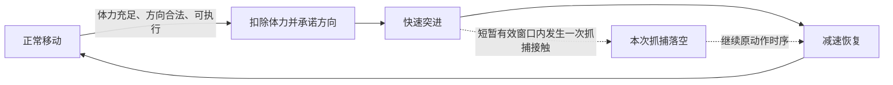

# 基础闪避：体力突进、预判与短暂完美窗口

本规格定义主角的基础动作，所有入场技能配置均可使用，不占主动技能栏。目标是在警察不同出手距离与追逐属性下，形成方向、时机、体力和落点选择。尚未实现或实测。

相关规格：[警察玩家风格与属性](警察玩家风格与属性.md)、[警察行为循环](警察行为循环.md)、[主动技能设计](追逐玩法扩展设计.md)。

动画接入困难时，采用 [原型可视化约定](原型可视化约定.md)：警察前摇红光，主角闪避白光闪烁，短暂无敌段白光增强，其余阶段不额外显示。警察前摇结束后立即判定。

## 1. 核心规则

- 按指定方向快速突进，释放时立即消耗固定体力。
- 开始时锁定突进方向；执行过程中转动镜头不改变已承诺的移动方向。
- 无方向输入时需要明确默认方向与提示，原型优先使用当前移动/朝向，后续由实际操作验证。
- 体力不足时不能释放，并提供反馈；不透支到负体力。
- 位移受墙面、障碍和可行走区域限制，不穿墙或穿过实心物体。
- 极短的完美闪避窗口仅占动作的一小部分；整段突进不提供持续保护。
- 动作结束后进入短暂减速恢复，随后回到正常移动。
- 成功避开抓捕后，仍需要处理追踪、视线、声音与下一次交锋。

## 2. 动作阶段

| 阶段 | 操作能力 | 主要风险 |
| --- | --- | --- |
| 承诺与启动 | 已扣体力、确定方向，经过固定的短启动过程 | 过晚输入可能来不及，方向错误无法无成本修正 |
| 突进 | 快速移动，只有一个很短的完美窗口 | 窗口之外仍可被抓；撞墙会损失位移 |
| 恢复 | 可以观察并保留少量受限移动，短暂降速 | 对方尚未出手或恢复较快时可继续接近 |
| 正常移动 | 恢复完整移动能力 | 已花费体力影响后续跑动与闪避 |

- 完美窗口相对动作开始的位置固定、可学习；不随警察暗中改变。
- 窗口具体位置、长度与启动过程先作为待调参数。
- 完美结果不取消恢复阶段，不返还全部体力，不清除追逐加速。
- 按住或连续输入不能跳过恢复；恢复期间不排队自动连续闪避。
- 碰撞提前截断位移时仍承担正常恢复代价，不能撞墙缩短动作周期。
- 其他技能不能取消闪避恢复以重置速度；如允许施法，仍保留原恢复时序。

## 3. 普通闪避与完美闪避

### 3.1 普通成功：主要依靠位置

- 在抓捕实际判定时，主角已离开范围、朝向扇区或利用有效遮挡，即为正常扑空。
- 提前预判可以可靠地争取位置，即使没有获得完美反馈，仍具有价值。
- 玩家要选择有用的出口与下一处遮挡，不能只追求闪避成功的音效。

### 3.2 完美成功：很短的接触应对

- 仅在短窗口内发生了原本有效的一次抓捕接触时触发。
- 如果已经完全离开抓捕范围，本次属于普通位置避开，不凭按键时机额外算完美。
- 完美使该次明确抓捕落空，采用警察正常的扑空后摇。
- 不撤销已经结算的抓捕，不同时取消所有警察的攻击。
- 多次或多警察接触要按各自实例结算；一次完美不能变成整段无敌。
- 当前仅以白光提示动作持续时间和短窗口位置；完美成功不额外显示，不追加隐身、静音、长眩晕或自由位移。

## 4. 预判优于只等前摇

需要同时观察：

- 当前距离与闭合速度。
- 对方是贴脸、极限还是随机距离出手。
- 对方是否已经承诺方向，以及其移动转向能力。
- 自己是否有足够体力，侧面或后方是否有可用落点。
- 对方可能谨慎取消或前摇试探，因此提前闪避也可能被延后出手惩罚。

用以下时间关系校准原型：

- 警察剩余判定时间：从玩家识别出前摇到真实接触的时间。
- 反应预算：识别、决定、输入和实际控制延迟。
- 闪避准备时间：输入后到达完美窗口/产生足够位移所需的时间。

若在随机距离首次出手时，反应预算加准备时间接近或超过剩余时间，只靠前摇临时反应就难以稳定获得完美。提前判断距离、准备方向与体力可以提高成功率。

设计目标是临时反应仍可能补救，但预先准备更可靠。保留明确可辨的前摇和固定判定规则，不以不可见攻击、每次随机命中时刻或读取玩家按键制造难度。

## 5. 不同出手习惯的应对

| 警察出手 | 较可靠的选择 | 过早或过晚的风险 |
| --- | --- | --- |
| 贴脸 | 较早转点，接近时预留横向空间；贴近后严格读取承诺 | 贴脸后才临时后撤可能位移不足 |
| 极限距离 | 提前准备后撤或横移，引诱边缘出手并拉出范围 | 无出口或方向错误时仍可能被追上 |
| 随机距离 | 观察其分布，预留体力与方向，在危险距离主动选择移动 | 只凭固定距离过早闪避会暴露恢复阶段，只等前摇又可能太晚 |
| 前摇试探 | 结合承诺信号与自身位置，减少无依据交闪避 | 被试探消耗体力后，下一次交锋更危险 |

## 6. 闪避与追逐属性的关系

- 高速低转向：侧向突进可利用方向承诺，但前提是落点可用。
- 中速高转向：闪避后容易重新修正追踪，需要把位移接到遮挡或另一路线。
- 高速低续航：自己也要管理体力，避免在其休整前把资源全部耗光。
- 低速高续航：初期利用位移转点，不能靠连续闪避一直拖到追逐加速积满。

## 7. 减速恢复与防赶路

完整动作周期包括启动、突进和恢复。原型比较同样时间内：

1. 正常奔跑的位移和体力消耗。
2. 连续合法闪避的位移和体力消耗。
3. 闪避接奔跑、技能接闪避的位移和体力消耗。

闪避可以在短瞬间获得距离，但完整周期的赶路效率不应持续优于普通奔跑，且资源成本更高。代价优先来自体力与真实恢复，不仅靠长冷却限制。

闪避默认会产生可听见的移动动静，结束后可能吸引调查。敛息是否覆盖该动静由声源分类明确决定，首版建议覆盖主角移动声，但不免除体力和恢复。

## 8. 与精准替身的差异

| 功能 | 基础闪避 | 精准替身 |
| --- | --- | --- |
| 成本 | 与奔跑共享的体力 | 入场技能栏与有限次数 |
| 主要作用 | 有方向的实际位移 | 一次抓捕目标误判 |
| 成功条件 | 方向、落点、距离与短暂时机 | 严格时机与指定抓捕实例 |
| 失败代价 | 体力消耗、错误落点、减速恢复 | 消耗技能机会，可能仍被追踪或其他警察抓捕 |
| 对准备的影响 | 每种配置都能用 | 占用一个主动技能选择，可兼顾普通留影 |

精准替身不自动附带额外冲刺；闪避不产生持续诱饵。先验证基础闪避，再重新评估替身的必要性与支配性。

## 9. 第一轮验收

- 不追求完美时，提前位置闪避是否仍有效？
- 在贴脸、极限、随机距离出手下，准备充分与临时反应是否产生不同结果？
- 随机距离影响决策时机，而非实际命中规则，玩家是否看得懂？
- 短窗口是否能被练习掌握，但不能通过连续输入稳定获得？
- 错误方向、撞墙和过早闪避是否留下明确可应对的后果？
- 普通跑动与连续闪避对照是否满足赶路效率要求？
- 完美成功是否保留恢复与视听追踪，防止成为万能脱身？
- 闪避与替身是否分别支持位置操作与技能资源选择？

首轮不锁定具体体力消耗、位移长度、窗口与减速时长。需要先测真实控制延迟、抓捕时序、角色速度与地图尺度，再确定数值。
