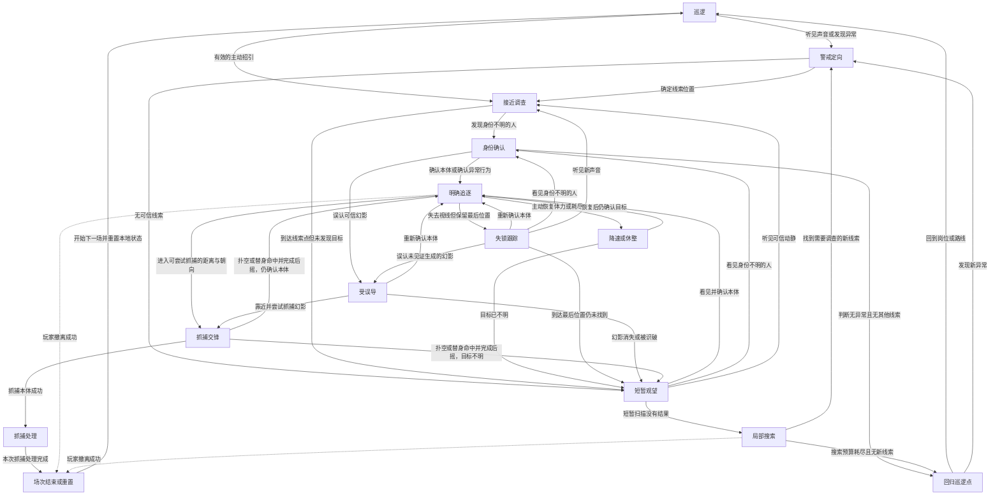
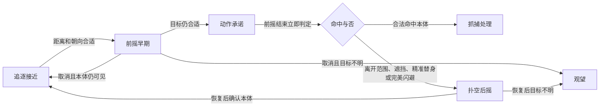

# 警察行为循环与节点行动

本图定义玩法扩展的目标规则，不代表已经确认的 Lillia 原生 AI。节点表示行为模式，节点内的行动是候选决策；感知、身份记忆和追逐压力在多个节点间持续存在。

玩法差异优先按 [警察玩家风格与属性](警察玩家风格与属性.md) 定义：假设不同属性与操作习惯的玩家扮演追捕者，再映射到本图。状态节点是共同流程，节点内的选择和操作能力构成实际对局风格。

相关规格：[主动技能设计](追逐玩法扩展设计.md)、[技能机制候选与收敛](技能机制候选与收敛.md)。

主角基础突进与短暂完美接触判定见 [基础闪避设计](基础闪避设计.md)。抓捕判定时统一检查实际位置、遮挡及该次抓捕是否被合法替身/完美闪避处理。

当前 [原型可视化约定](原型可视化约定.md) 只显示抓捕前摇红光及主角闪避白光；不区分其他阶段颜色。抓捕前摇结束后立即判定一次。

## 1. 完整行为循环

图中的撤离虚线代表场次级事件，其他行为节点也可以收到这个事件；是否满足撤离条件由撤离系统独立判定。没有玩家或相关实体后清理追踪，不继续搜索已经结束的场次。

明确、有效的本体目击也可以让巡逻、定向、调查等节点直接进入追逐；图中经过身份确认的路径用于表达身份尚不确定的情形。

## 2. 每个节点的可选行动

| 节点 | 决策时可选行动 | 选择依据 | 玩家可以利用的机会 | 离开节点的条件 |
| --- | --- | --- | --- | --- |
| 巡逻 | 沿路线走、岗位停留、看向侧面、短暂检查常见位置 | 岗位、路线、个人谨慎倾向 | 等待朝向变化，观察稳定倾向 | 实际感知异常或直接确认本体 |
| 警戒定向 | 原地转向声源、向声源走几步、观察异常方向、短暂等待第二条证据 | 线索位置、强度、新鲜度、是否有遮挡 | 及时静音、转移、引开注意 | 确定调查方向，或线索不足 |
| 接近调查 | 快速接近线索、谨慎接近、查看转角、选择可到达的侧路 | 路线、危险程度、可观测信息 | 改变声源位置，在对方行动期间绕行 | 发现人、找到线索或到达后无结果 |
| 身份确认 | 对准观察、适度靠近、短暂停步确认、根据异常行为升级判断 | 外观、此前身份记忆、距离、目击连续性 | 合理伪装、维持普通行为、利用确认时间 | 确信异常、确认普通身份或转向其他线索 |
| 明确追逐 | 直接接近、基于可见方向绕截、调整距离与朝向、在条件成立时准备抓捕 | 当前视觉、合法路线、追捕决心、出手倾向 | 假动作、转角、接近交互点、诱导提前出手 | 丢视线、进入抓捕或场次结束 |
| 降速或休整 | 放慢恢复、短暂停留、继续朝目标方向观察 | 自己的体力、当前视觉与声音、续航配置 | 利用恢复窗口拉距或转移，也可能被继续目击 | 恢复后续追，或目标不明转向观望 |
| 失锁跟踪 | 去最后看见的位置、延续最后可见方向一小段、在拐角停步、调查确实听见的新声源 | 最后位置和方向、经过时间、新声音、个性 | 反向走、静音、留下可信分身 | 重获目标、误认幻影、改查声音或需要观望 |
| 受误导 | 接近幻影、短暂停步确认、按合法条件准备抓捕 | 对幻影的可信判断、出手倾向、实际距离 | 利用暂时错误的目标选择转移 | 幻影消失、被识破、尝试抓捕或发现本体 |
| 抓捕交锋 | 前摇早期调整或取消；进入承诺后完成一次动作；判定后执行恢复 | 距离、朝向、合法中断事件、判定时位置 | 精准替身、位置闪避、场景遮挡 | 见第 3 节抓捕子循环 |
| 短暂观望 | 原地看左右、面向最后方向观察、向前几步再看、转向实际听到的声音 | 最后证据、扫描范围、警察个性 | 安静转移、保持遮挡、利用身份确认差异 | 发现本体、发现身份不明的人、听见动静或扫描结束 |
| 局部搜索 | 查最后位置、查实际新声源、查附近已知藏点、沿可达分支搜索、结束无效调查 | 合法搜索点、线索新鲜度、搜索预算 | 在检查一个位置时转移到另一处 | 新线索或预算耗尽 |
| 回归巡逻点 | 返回岗位、接回原路线、途中正常观察 | 岗位与可走路径 | 趁巡逻重排完成任务，继续保持隐蔽 | 抵达或发现新异常 |
| 抓捕处理 | 进入已确定的抓捕结果流程 | 已成功结算的本体抓捕 | 追逐操作已经结束；后续逃脱如需设计应另建状态 | 结果流程完成 |
| 场次结束或重置 | 清除本场目标、幻影、旧线索及临时效果，初始化下一场 | 场次事件 | 重新准备配置 | 新场次开始 |

“前进、停步、调查声音”等随机反应发生在合法决策节点。抓捕判定后有后摇时，先完成后摇，再选择观望或重新追逐。

## 3. 抓捕子循环

- 前摇早期允许有限转向和取消，动作表现必须可辨认。
- 承诺阶段限制转向与重新选择目标，玩家可利用此前读到的动作。
- 前摇结束立即进行一次判定，判定自身不另设可视化。
- 判定依据此刻的位置、朝向与遮挡；不是进入前摇就预先决定命中。
- 精准替身只改变一个指定抓捕实例的结果，不取消其他警察的抓捕。
- 本体已经被成功抓捕后，不用新技能或新线索撤销结算。
- 后摇期间可以记录新的实际感知，但不能提前移动或立即出第二次抓捕。
- 后摇完成时读取最新证据，选择追逐或观望。

## 4. 感知证据与记忆

每名警察分别保留：

| 信息 | 更新来源 | 不能推导出的信息 |
| --- | --- | --- |
| 最后确认位置、方向与时间 | 合法视觉目击 | 玩家后来在墙后走到了哪里 |
| 已听见的声源位置、强度与时间 | 实际听觉范围内的声音事件 | 静音后的持续真实坐标 |
| 本体外观与身份确认程度 | 连续目击、重新观察、异常行为 | 未见证换装或伪装过程后的即时确定身份 |
| 当前关注实体与可信度 | 视觉、记忆及调查结果 | 仅凭内部实体标签就知道分身真假 |
| 搜索范围、已查地点与剩余预算 | 已执行的调查与新线索 | 无限重复搜索必定找到玩家 |
| 行为倾向 | 本场生成后保持稳定 | 每帧重新随机的人格 |

新的声音只产生新线索。明确看见本体时，不因为边上出现弱声源而随意丢弃更可信的视觉证据。

## 5. 技能对应的介入点

| 技能 | 主要介入节点 | 改变什么 | 保留什么 |
| --- | --- | --- | --- |
| 普通留影 | 失锁跟踪、接近调查、身份确认 | 可信情况下关注实体被误导到幻影 | 其他真实目击、声音、识破后的扫描 |
| 精准替身 | 动作承诺到判定之间 | 一次抓捕结算对象与结果 | 正常扑空后摇、本体可能仍被看见 |
| 敛息 | 警戒定向、失锁跟踪、观望、搜索 | 不再产生有效的主角移动声音 | 旧声源、本体视觉、身份记忆 |
| 幻衣 | 身份确认、观望、搜索 | 重新识别所需证据 | 连续目击、近距检查、异常行为 |
| 魅惑招引 | 巡逻、身份尚未确认的搜索 | 目标朝向和有限接近行为 | 后续识别风险、原有记忆、已确认追逐 |
| 侦察候选 | 巡逻、接近、搜索 | 玩家获得局部可行动信息 | 实际威胁和执行难度 |
| 机动候选 | 追逐、转点、抓捕前 | 玩家位置或可用通路 | 出口风险、声音与重新目击 |

## 6. 决策、个性与动作承诺

一次决策采用顺序：

1. 接收实际感知和必要的场次事件。
2. 保留尚未完成的抓捕承诺、后摇等动作。
3. 在可重新决策时，检查目标确认程度与需要切换的节点。
4. 根据场景过滤不可执行的行动。
5. 根据基础权重、固定个性、当前证据和状态调整权重。
6. 从合法行动中抽取一个，短暂执行后再评估。

决策触发包括：抵达调查点、失去目标、动作结束、幻影消失、出现需要重新评价的可信线索。正常行动过程中维持感知，但不因每帧随机而左右摆动。

| 个性维度 | 可观察的倾向 | 玩家可能利用的弱点 |
| --- | --- | --- |
| 冒进 / 谨慎 | 抓捕尝试更早，或更常接近后确认 | 冒进者可诱导扑空；谨慎者给拉距时间但不容易误认 |
| 延续方向 / 停步复核 | 丢视线后向前走，或先看转角 | 可尝试反向与侧向转移，仍要观察实际反应 |
| 听觉关注 | 更常优先调查可信声音 | 可利用声音引导，但不能保证无视明确视觉 |
| 搜索耐心 | 更愿意查多个合法点，或较早回岗 | 可针对搜索顺序转移，或者等有限搜索结束 |

差异只调整合法行动的概率，不允许穿墙感知、瞬间转向、跳过后摇。存在多个合适行动时保留不确定性；只剩一个合法行动时不为随机而制造错误动作。

上述概率用于决策风格；移速、移动转向和续航配置另外限制动作执行。概率变化不替代真实的属性优劣。

## 7. 心跳、追逐状态与加速

三者独立处理：

- 心跳或基础预警：反映附近威胁，不仅在明确追逐时才出现。技能不能让基础规则无法判断。
- 目标追踪：明确追逐、失锁跟踪、受误导、观望与搜索有不同确认程度。
- 追捕决心：根据当前可信目标的连续有效追踪积累压力，在失去确认与无效搜索期间暂停或消退。

只在地图上稍微离远不能无条件结束清楚可见的追踪。失去视线后也不能马上清空全部加速；玩家仍需处理失锁跟踪与搜索。

警察相信幻影时，行为依据自己的证据。不能通过“此实体是分身”的内部信息提前改变反应；识破后再进入观望并调整追捕决心。

## 8. 事件优先级与循环边界

- 场次结束、实体移除等事件终止本场行为并清理临时状态。
- 成功抓捕已经结算时进入结果处理。
- 抓捕承诺和后摇遵守自己的阶段规则，技能只能介入明确允许的窗口。
- 在允许决策的节点，明确本体目击优先于不确定的弱线索。
- 新线索、身份判断与幻影识破决定下一行为节点。
- 没有新证据时，搜索受预算约束，最终可以回到巡逻。
- 路线不可达、目标消失或动作异常时，回到合法调查/观望节点，不保持永久追逐。
- 多名警察分别维护感知与抓捕实例；首版不默认共享本体真实坐标。后续如加入报告，只传递报告发生时的证据。

## 9. 完整循环验证案例

1. 跑动声吸引警察：巡逻 → 定向 → 调查 → 发现本体 → 追逐。
2. 无异常声源：巡逻 → 定向 → 调查 → 观望 → 搜索 → 回岗 → 巡逻。
3. 拐角分身：追逐 → 失锁跟踪 → 误认幻影 → 幻影消失 → 观望；看见本体则续追，否则搜索。
4. 精准替身：追逐 → 前摇 → 承诺 → 替身命中 → 后摇 → 根据实际视觉续追或观望。
5. 静音转移：失锁跟踪仍到旧位置；没有新的脚步证据，经过观望与有限搜索后放弃。
6. 伪装穿过扫描：观望 → 发现身份不明的人 → 身份确认；近距或异常行为可识破，普通行为可能通过。
7. 主动招引：巡逻 → 被引向主角位置 → 调查/身份确认；玩家绕行成功或被确认后升级追逐。
8. 两名警察证据不同：一名误认幻影，另一名仍目击本体，各自按循环行动。
9. 撤离成功或本体抓捕：进入场次级处理，结束本轮相关 AI，不留下无限搜索。

首个原型先验证单警察、基础视觉与声音、抓捕子循环和有限搜索，再加入个性概率与多警察场景。
