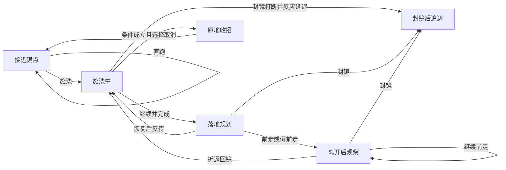

# 镜子交互：首轮独立单元

## 共享 AI 脚本重构约定

### 第二阶段：通用移动、闪避、抓捕与测试分层

`ai-actions.mjs`现统一实现玩家移动意图（步行/跑动、体力、后摇减速）、普通警察追逐移动、闪避准入和阶段推进、抓捕状态创建/转向/前摇/活动判定时机/恢复推进。模块不依赖World、Unity或真实敌方对象。宿主执行碰撞/位移、命中检测和原生表现；抓捕只接收已知目标位置、可见标志及最后目击位置，隐藏目标不能进入转向决策。动作状态为普通数据，可序列化后继续推进。

普通玩家AI已拆为`bot-mind.mjs`与`bots.mjs`适配器：后者采集`buildAIContext`并调用共享`step(context)`。反应队列、倾向、路线记忆和决策仍由脚本维护。镜子采样沿用上一物理步时间戳，普通玩家在step之前采样当前时间，避免重构额外引入一帧延迟。

闪避、抓捕和镜子共用角色级动作反馈账本（`world.actionFeedback`）。闪避拒绝重复请求/体力不足，报告突进/恢复与正常完成；完美成功通过既有规则取消自身恢复。抓捕拒绝覆盖活动动作或在冷却/传送锁定中启动；落空后报告running/recovery，完整后摇结束才failed；命中才succeeded。对局结束将尚未完成的动作标为interrupted，不能把停止更新或空闲当作成功。新增请求被拒绝不会清除已有活动动作。

当前固定数值不再作为调参任务：零启动、0.3s×2突进、0.6s线性恢复、0.1s完美窗口，以及已验证轻重刀数值保持。默认`npm test`检验当前规则、不变量、动作反馈与集成；旧0.04s启动/短突进/固定前冲/常量恢复对照移到`tests/historical/`，通过`npm run test:historical`单独检查旧配置兼容，不作为当前平衡验收。没有删除旧预设或旧回放支持。

本阶段仍未接入Unity/Jint。普通警察搜索编排和镜子阶段执行器仍需继续迁移；脚本发出幂等请求、宿主确认的完整协议尚待接入（目前编号仍由动作入口生成）。导航仍是受限查询接口。以下“第一阶段”完成范围为历史进度；其中闪避/抓捕仅阶段快照的限制已由本阶段反馈账本替代。

第二阶段验收：当前回归132项、历史兼容11项全部通过；浏览器210组/420局批量、Node回放一致性、接管、重开与取消检查通过，JavaScript错误0。本次没有重新调参或重跑均衡训练。

模拟器与未来 Unity/BepInEx 插件应执行同一份决策脚本。宿主每帧更新 Context；脚本维护独立角色记忆、延迟观测、决策承诺与动作进程，不按每帧重新抽样策略。当前阶段先隔离镜子 AI 的感知采集与决策输入，保留已验证动作执行器，逐步迁移，不能宣称已完成游戏侧接入。

Context 只包含自身状态、当前能感知的信息、公开场景规则、交互信息和执行反馈。观察到的动作仅提供可见阶段和估计时序，隐藏跟传准备、对手策略与真实不可见位置不得进入决策。自身动作可获知精确阶段。作弊信息未来必须作为显式、默认关闭的能力单独提供，不得隐含在普通 Context 中。

输出区分持续移动/朝向意图与一次性动作请求。闪避、抓捕、传送等请求最终需有 requestId；宿主确认 accepted/rejected，持续回报 running 的具体阶段及 succeeded/failed/interrupted。被拒绝不能当成已启动，决策优先级不能绕过后摇与中断规则。脚本可以提出下一计划，当前动作的合法执行仍由动作阶段机约束。

新增玩法的动作阶段机最终归共享核心管理，宿主负责碰撞、命中与动画反馈；已有原生动作通过适配器兼容。警察移动接管时必须明确导航、根位移、朝向的唯一控制者，退出接管恢复原状态，不能脚本位移与原生移动叠加。实际位置由执行反馈确定，不将期望位移当作真实位移。

第一阶段允许以受限几何查询接口连接现有导航，禁止把 World 或真实敌方对象交给决策。这是迁移桥梁，尚不是可直接序列化的最终跨宿主协议；后续替换为导航查询结果 DTO 和命令/确认通道。验收先覆盖不可见对手与隐藏跟传的非干扰性、动作阶段反馈、原有单元回归，再做浏览器与 Jint 的同输入同种子逐步一致性及性能验证。

第一阶段实现：`ai-context.mjs`负责宿主采集和白名单快照，`mirror-mind.mjs`保留角色记忆、反应延迟与策略，`ai-police-control.mjs`计算移动/朝向意图及抓捕起手，`mirror-ai.mjs`成为模拟器适配入口。`ai-rules.mjs`提取纯规则，使共享决策模块不再通过导入`core.mjs`加载整个世界执行器。静态导航能力缓存，只有观测采样入口检查即时视线；决策与移动控制沿用脚本延迟记忆。

`ai-action-feedback.mjs`提供独立动作反馈账本，镜子已接入：请求有唯一编号；启动返回accepted/rejected；落地和主动取消收招为running；完整落地后succeeded；封镜、占位、受击或完成取消收招为interrupted。另一个请求被拒绝不覆盖正在执行的动作。账本保留最近32条自有事件；尚非可靠传输队列，未来跨宿主需增加确认和保留策略。当前编号在宿主接受请求入口生成，后续应前移到脚本输出以实现跨帧幂等请求。

明确未完成：闪避和抓捕目前仅有自身阶段快照，尚未完整接入请求/终态账本；新增玩法阶段机仍在模拟器执行器中；普通非镜子警察AI、固定单元脚本、导航DTO、全量记忆序列化、可插拔通用行为图、Jint及游戏移动接管待迁移。本阶段不修改游戏DLL，不代表已验证Unity兼容或完成全部重构。

第一阶段验证：134项Node测试通过，包括新增的Context信息隔离、隐藏目标移动不改变决策、拒绝新请求不覆盖活动动作、镜子阶段与完成/中断反馈。24局带日志及物理的Node实测累计约439.99s模拟时间、耗时4.78s，仅作本机当前运行参考，不是重构前后对比或Unity/Jint性能保证。前台镜子预设可加载并推进，已检查一次截图。

浏览器完整回归通过：210组、420局，浏览器/Node回放一致，接管、草稿、重开及取消检查通过，JavaScript错误为0。测试等待改由Node轮询并记录进度，避免依赖后台页面计时。批量计算使用独立worker，取消直接terminate；移除其无必要的setTimeout让步，减少后台标签页定时器节流带来的停顿。

## 最新阶段结果：交互点应偏向人类，当前尚未达标

系统设计目标：合理使用镜子通常应比放弃交互更有利；正确读招进一步扩大收益，少数错误决策才给警察反收益。双方策略均衡不能替代这一要求，也不要求人类与警察胜率各半。以下是有限策略库候选，不是完整GTO。

本轮累计43,200场模拟。早期相邻种子训练在第三组种子上失效，已保留历史报告；最终修复接近入口的安全估计漏算走回镜点时间的问题，使用12个分散训练种子与12个独立分散验证种子，每组双方12×12策略、6种场景，共20,736场。分别训练低/高暴露策略；验证数据不参与拟合。玩家1s施法+1s后摇、警察2s跟传+1s锁视角未调整。

| 独立验证指标 | 低暴露0.15 | 高暴露0.85 |
| --- | --- | --- |
| 有限策略库上下界差（0—1综合分） | 0.00146 | 0.04882 |
| 上下界差的种子块95%区间 | 0.00138—0.05223 | 0.01566—0.09584 |
| 人类主要训练策略 | 试探假前走94.89% | 谨慎假前走59.32%、直跑优先24.46%、不交互10.39% |
| 警察主要训练策略 | 施法时斜切、确认传送后截出口99.40% | 施法时斜切、确认传送后跟传97.56% |

低暴露点估计稳定，但区间仍较宽；高暴露验证中“不交互”是库内更好的单方反制，表明策略泛化和交互收益均未完成收敛。权重集中也说明当前库没有证明丰富的混合博弈。

相对同场景、同种子、同警察混合的“不使用镜子”策略，6类场景中4类综合分为正，但72个场景/种子配对仅31个为正；平均差−0.00025，95%区间[−0.01918,0.02135]。不能据此宣称大多数对局受益。

| 场景 | 低暴露收益差 | 高暴露收益差 |
| --- | --- | --- |
| 初始领先 | +0.08234 | −0.15173 |
| 较近追逐 | +0.05196 | −0.02997 |
| 警察位于两镜之间 | +0.00874 | +0.03714 |

这里是综合分差，不是胜率百分点。高暴露领先场景中，镜子候选平均少1.51次成功闪避、少1.81s坚持时间，虽多保留10.56体力，仍不足以补偿当前目标下的损失。低暴露领先场景脱身率增加约16.87个百分点、剩余体力增加18.11；因更早脱身，坚持时间缩短不等于负收益。近追逐场景平均传送不足0.09次，结果主要反映交互选择/绕行策略，不能当成镜子本体收益证明。

下一轮优先检查高暴露转点后的继续追逐与续航收益、错误反传的条件性惩罚，而非通过修改计分或弱化警察强行达标。当前“冒险反传相对谨慎前走”的惩罚随场景反号，也尚未证明只有少数失误才给警察优势。

前台选择“镜子均衡候选 · 低暴露：转点脱身”或“高暴露：持续攻防”，同一种子可复现双方整套策略抽样；意图栏显示抽样ID供白盒检查，AI不读取对手ID。暴露度低于0.5选择低暴露权重，否则选择高暴露权重；中间暴露度未单独验证。要手工调节点规则，请移除JSON中的`mirror.ai.integration.mixtureByExposure`，否则初始化会按抽样策略设置规则。

复现：`node sim/chase-lab/audit-mirror-context.mjs --fresh`，随后运行`analyze-mirror-context.mjs --fresh`与`render-mirror-game.mjs --fresh`（后二者同目录）。最终报告为`artifacts/chase-lab/mirror-game/context-v2-report.json`，可视化为同目录`index.html`。下节6训练/12验证的描述是第一轮历史方法；最终候选以本节为准。

## 策略收敛与交互点收益的两层检验

设计目标明确为：镜子在多数合理使用条件下给人类净收益，成功博弈能扩大优势，错误反传/取消/转点可被警察惩罚。不是把交互点调成双方五五开。均衡检验与交互点收益检验分别进行，不通过修改计分把交互强行评为有利。

本轮只调整策略，不改变原生参数、空间缩放、闪避/抓捕性能以及玩家镜子1+1、警察2+1时序。修复前走到局部目标后停止/反复回到目标点的问题；新增谨慎反传与折返策略，计算守候风险、回镜路程及施法时间，保留冒险反传作为可被针对的策略。指令抽样改用独立随机流，避免改变策略权重时连带改变反应延迟样本。

`dist/mirror-strategies.mjs`定义双方各12种完整条件策略。先在原8×8策略库求解，再加入双方各4种未进入初始库的反制探针，检查原混合的最佳反应收益并重新求解扩展12×12矩阵。这里是有限完整策略库的经验零和近似，不是连续动作空间的精确GTO，也不是只凭随机出招或50%胜率命名均衡。

训练与验证采用同起点、同种子配对：3种初始位置（足够领先、较近追逐、警察位于两镜之间）×2种暴露度（0.15/0.85），各策略组合共用这些场景。每局最多20s；6个训练种子与12个独立验证种子不重叠。策略抽样每局分别选择双方完整策略，不把条件策略的节点权重简单平均，也不向另一方AI公开抽样策略ID。

收益沿用框架的暴露度权重：脱身权重`0.6−0.45×暴露度`，成功躲避权重`0.25+0.3×暴露度`，剩余权重给坚持时间；躲避以6次归一化，坚持时间以20s归一化。局部“脱身”需连续失去警察视觉、无新近脚步声、间距超过6m，持续至少当前`escapeDelay`；超时单列，不视作脱身。该脱身条件只用于局部评估，不更改原有镜子场景的核心结束规则。

独立验证同时比较最优库内反制收益（exploitability gap）和“不使用镜子”的配对收益。另列坚持时间、脱身、闪避、剩余体力与使用次数，防止单一分数掩盖交互点退化。误判对照比较冒险反传与谨慎前走，不把两者不同的起点或警察策略混为收益。置信区间按验证种子整块重采样，保留同种子各场景/策略的相关性。

运行 `node sim/chase-lab/train-mirror-game.mjs` 生成矩阵与候选混合，再运行 `node sim/chase-lab/analyze-mirror-game.mjs` 生成配对种子块的不确定性及错误反传对照。报告位于`artifacts/chase-lab/mirror-game/report.json`，混合配置位于同目录`mixture.json`。均衡权重只能结合该收益函数、场景分布与策略库解释。

## 集成测试：决策节点、可组合指令与分支覆盖

新增五个前台预设：“镜子集成·混合分支 / 直跑到另一镜点 / 落地准备反传 / 假前走再折返 / 连线内斜切取消”。使用当前玩家1+1、警察2+1参数，双方通过延迟观测连续决策；取消预设从已开始施法的条件进入，其他预设从第一次交互之前开始。旧固定单元及旧自由AI预设继续保留。

| 决策节点 | 可发起指令 | 条件与执行约束 |
| --- | --- | --- |
| approach 接近镜点 | run-exit 直跑另一镜点；teleport 发起传送；evade 应对追击 | 直跑比较双方到目标点的路线时间并检查体力；施法检查入口可承受时间、次数及取消后的再决策间隔。不在交互范围则先接近镜点。 |
| casting 施法中 | continue 维持；cancel 取消收招 | 警察在连线走廊外不考虑取消；走廊内还须看到移动轨迹朝出口、出口受威胁且入口可承受1s取消收招。取消分支可按概率赌博。 |
| landing 落地后摇及镜旁恢复 | return 准备反传；forward 前走；feint 假前走 | 后摇期间仅改变计划，不提前移动、施法或恢复体力。准备反传仍可能赌错守候；近入口守候者会降低混合策略反传权重，而偏科反传预设会刻意保留这一失败样本。 |
| departure 离开后再判断 | forward 继续前走；turn-back 折返回镜；evade 应对追击 | 必须已离当前镜点1.5m、未离开超过6m、看到对方移动且镜子仍可用，才能发起折返；开始折返后不要求一直保持最小离镜距离。回镜仍受碰撞、施法与封镜限制。 |
| recovering 取消后摇 | wait 等待恢复 | 不允许指令绕过后摇；之后另留1s再施法间隔，避免频繁取消循环。 |
| sealed 已封镜 | forward 前走；evade 常规追逐 | 取消所有反传选项。 |
| police-followup 警察确认传送后 | follow 跟传；intercept 截出口；wait 守入口；fake 假跟传 | 沿用延迟目击、到入口/出口的时间估计及守候可达范围。近身攻击、有限转向、镜点搜索、跟传与后摇的强制阶段继续由警察控制器处理，不允许指令越过物理锁定。 |

“连线内”定义为投影落在两镜之间、横向距离不超过`corridorWidth`的有限走廊，默认1.5m；不是无限直线，也不要求数学意义上完全共线。玩家只使用自己动作状态与延迟合法观测，不读取警察隐藏的跟传前摇。警察施法响应、目标失踪检查等已有分支通过`policeBranches`记录转换，确认传送后的四分支接入同一指令仲裁器。



指令仲裁顺序：合法条件过滤→`probability`通过判定→取最高`priority`→同级按`weight`抽取。当前指令在`duration`内保持，同级不会不断抢占；更高优先级可覆盖，当前指令不再合法、节点改变或到期则重新选择。默认优先级10，已观察到攻击时的常规应对默认100。一般节点每0.4s复评，施法风险按玩家AI决策间隔（默认约0.1s）复评。落地可先计划，动作执行仍等物理后摇结束。

前台AI意图下方可选玩家／警察、选择指令并点击“发起指令”，提交一次优先级50、持续1s的请求；不在该节点或不满足安全/合法条件会被拒绝。警察请求在确认传送后的策略节点处理，不会凭指令获知隐藏位置。按钮发出的请求写入输入记录，回放可复现物理结果。候选评估日志随导出文件保存；输入回放不重新运行玩家决策，故原决策统计应读导出的`branchStats`和`events`，不要把回放时新生成的局部日志当原统计。

JSON参数示例（填写在`mirror.ai.integration.rules`内）：

```json
{
  "approach": {"teleport": {"priority": 20, "weight": 2}},
  "casting": {"cancel": {"priority": 30, "probability": 0.65}},
  "landing": {"feint": {"weight": 3, "duration": 1}},
  "departure": {"turn-back": {"priority": 25, "probability": 0.7}},
  "police-followup": {"intercept": {"priority": 20}}
}
```

程序入口为`issueMirrorCommand(world, 'return', {actor:'player',priority:50,probability:0.7,duration:1})`；若需输入回放，应将请求放入单帧`input.mirrorCommands=[{action:'return',options:{actor:'player',priority:50,probability:0.7,duration:1}}]`。概率是每次评估/发起的通过概率，不是整局策略占比；不能根据配置0.7就声称最终70%会反传。

后台入口：`node sim/chase-lab/run-mirror-integration.mjs`，默认5种人类预设×5种警察后续权重×12种子，300场、每场最多15s。可用`--preset mirror-integration-feint --seeds 12`缩小范围。输出：

- `artifacts/chase-lab/mirror-integration/report.json`：配置样本、每局分支统计、种子1的完整事件及总体聚合。
- 同目录`branches.csv`：节点进入局数、进入次数、评估次数，以及每行动被提出/满足条件/被选择次数。
- 同目录`transitions.csv`：指令之间的实际转换次数。

首轮覆盖：300局中接近节点300局，施法295局、落地295局、离开再判断216局、取消恢复79局、封镜后117局、警察确认传送后295局。所有列出的行动分支都有实际选择。被抓180局只用于确认失败链存在；不同预设有刻意偏科且起手条件不同，不能视为公平胜率或GTO结论。`selected`统计每次评估结果（包括保持当前指令），`visits`才是节点进入次数，不能混算独立决策次数。条件不满足原因及证据快照保存在`mirror-decision`事件中。

119项自动测试通过，新增覆盖优先级抢占、概率0、非法指令拒绝、有限连线走廊、隐藏跟传不可见、落地仅规划、假前走最小距离、确定性及外部警察指令输入回放。后台截图已核对指令入口、节点状态与转向轨迹。后续重点是调整混合策略的守候风险判断与分支权重，而不是再靠固定时间脚本保证反传成功。

## 当前生效参数：玩家1s＋1s，警察2s＋1s

玩家施法前摇固定候选1s，成功传送落地与主动取消共用1s后摇；警察跟传前摇2s，完成传送时立即封镜，再经历1s落地锁视角、不能移动与视觉获取。这里的1s警察后摇仅指镜子跟传，抓捕落空后摇仍1.5s。参数面板保留调参能力，既有草稿与回放不自动迁移；加载原始预设才应用新候选。“较长落地恢复”明确对照预设仍为玩家1.2s。

落地交错/打断单元将警察起手等待从1.7s改为0.6s，以独立模拟较早跟传承诺：0.6s起手、2.6s封镜、3.6s恢复。玩家及时反传约2.008s完成，迟反传约3.208s完成，分别覆盖交错与打断。此0.6s仍为条件化单元时间，不等同于自由AI真实跑到入口的耗时。

新默认时序及1s锁向已加入回归，共109项自动测试通过。历史1.5/0.8/0.8规则的关键兼容性测试显式保留旧配置，避免将旧回放兼容与新参数收益混淆。原“短领先距离”起点已收近以继续覆盖无法安全施法的边界。新参数下，自由AI在原偏科截出口12种子中未选择反传，不能继续沿用旧版反传频率结论；固定落地单元仍验证反传机制。

下方各节的旧时间、距离与统计是历史实验，当前值以本节及重新生成的报告为准。

## 最新更新：落地单元的后续应对与时间边界

之前的固定截出口脚本始终以B为终点，固定假跟传始终守A，缺少反传后的转向和放弃守候。现补齐：玩家传送落地后，单元在`observeDelay`（默认0.25s）后向警察发送落点朝向指令，按当前朝向的最短角差、现有转向速度转动，不瞬转。截出口与普通追逐随后用延迟目击更新目标。这里的落点通知是条件单元的已知事件，不能当作自由AI穿墙获知传送；自由AI仍由合法视觉证据驱动。

封镜打断玩家施法后，AI增加`restartDelay`默认0.35s的起步反应延迟，面板可调0.2–0.5s。真人接管输入不额外强制延迟。警察下方增加抓捕前摇/后摇、跟传前摇/落地锁向倒计时。跟传前摇标注“调试”，仅供白盒观察，不进入玩家AI观测；正式游戏不能据此暴露真假跟传。

跟传交错的关键条件：玩家反传完成时刻必须早于警察封镜；若还要求回A时警察已经承诺跟传，则需满足 `警察跟传起手 < 玩家反传完成 < 警察跟传起手 + 0.8s`。当前玩家落地0.8s、施法1.5s，在120Hz输入下及时反传约2.308s完成。警察1.7s起手、2.5s封镜时，玩家额外等待0.3s即会被打断；警察2.0s起手时，等待0.3s仍可交错、等待0.6s会被打断。面板新增“落地后等待反传”，配合“延迟跟随等待”测试边界。固定跟传脚本不根据已回A的玩家临时改为出刀，因此“玩家先回A，警察之后才起手”只算完成反传，不能误算成功骗出承诺跟传。

`node sim/chase-lab/run-mirror-boundaries.mjs`生成30组跟传时机与36组守入口条件，输出`artifacts/chase-lab/mirror-landing/boundaries.json`。守候矩阵固定站位，测试后摇0.4/0.8/1.2s、反应0.2/0.35/0.5s，以及向左偏移0/1/2/3m。后摇内命中分别0/12、2/12、3/12，**是枚举条件数，不是胜率**；远离落点后固定原地守候不再具备直接抓后摇条件，不能外推为移动追逐也抓不到。

贴近原落点时，0.2/0.35/0.5s反应对应落地后约0.542/0.692/0.842s命中。前两者命中0.8s后摇，后者在后摇结束后才命中（脚本没有主动闪避）。判断是否抓后摇，应看“反应＋转向到可攻击角度＋接近＋攻击前摇”是否小于剩余后摇，不能只看警察最终是否抓到。

当前建议保留后摇不能闪避：允许随时闪避会削弱“误判假跟传、主动回到守候者身边”的惩罚；尤其完美闪避返还成本并取消自身后摇，可能把错误反传转成免费收益。当前边界测试尚未证明这是万能操作，也未实现后摇闪避机制；先保留可辨认的风险。若真人测试显示负反馈过强，再对照“仅后摇末段允许普通闪避、仍付体力、不能触发完美奖励”，不要直接开放完整完美闪避。

假跟传现在看到玩家离B超过2.25m并经过0.25s反应后止损。新增“落地应对·前走逼出跟传 / 前走逼出普通移动追逐 / 识别移动追逐后回头反传”。玩家回头版本只有看到警察开始移动并经过观察延迟后才回B，付出折返与施法时间；默认约2.608s开始反传、4.108s回A，警察4.358s改向。跟传止损与普通移动追逐在3.5s的距离分别约12.44m与18.83m；回头反传场景在同一时刻尚在施法，不能仅比较该瞬时距离评价收益。

108项自动测试通过，覆盖转向延迟、封镜后0.2/0.35/0.5s停顿、警察止损及玩家观察后折返；已截图检查警察倒计时。更早章节中的固定挂机结果已被本次后续逻辑取代。

## 当前更新：截出口折返修复与落地反传单元

“取消单元·假截出口”种子42的旧日志：2.325s选择截出口，4.158s定时重抽为守入口，4.258s止损又改为回入口跟传。原因是策略重抽覆盖了已经执行的拦截，且守入口失败的止损固定选择跟传，没有比较路线。现在截出口承诺保持至新传送证据改变目标；守入口/假跟传只在能及时返回入口的范围内入选，放弃守候时比较直接追逐与经镜子跟随的路线用时。

信息规则：只有警察跟传前摇无独特动作，与原地等待相同。玩家施法、取消后的原地收招、成功传送后的落地恢复都有可辨识动作。警察看见落地动作后可直接确认到达哪一端，不必连续看见瞬移；识别仍受视野和反应延迟限制。取消收招不作为传送证据。人类AI仍不能读取警察隐藏的跟传前摇。

新增参数方案（均以A已传到B、B落地后摇尚未结束为起点）：

| 前台预设 | 固定对策及验证结果 |
| --- | --- |
| 落地单元·截出口被反传拉扯 | 警察从两镜之间斜切，玩家及时反传；3.5s间距17.40m。警察起点改为x=0时会在反传结束前抓到，保留距离门槛。 |
| 落地单元·跟传遇及时反传：双方交错 | 玩家约2.308s回A，警察2.5s去B并封镜；3.5s间距17.33m。 |
| 落地单元·跟传封镜打断迟反传 | 玩家约2.008s才开始反传，2.5s被封镜打断，B侧次数未扣；3.5s间距4.86m。打断不等于保证命中，仍有警察落地锁向。 |
| 落地单元·假跟传守入口抓落地 | 玩家回A后约0.3s被抓，发生在0.8s落地后摇内。 |
| 落地单元·假跟传被前走拉开 | 玩家B落地后直接前走，警察固定守A；3.5s间距28.40m。 |

这些是条件化固定策略脚本，非自由AI胜率。双方均不取消施法，及时/迟反传按公开时序输入；警察固定守候的代价不能外推成智能警察无限挂机。跟传与假跟传在传送完成前保持相同位置、朝向、速度，方便接管体验信息博弈。沿用玩家1.5s施法、0.8s后摇，警察0.8s跟传、1s落地锁向；跟传启动时间默认1.7s，可用“延迟跟随等待”调整。单元使用真实碰撞、攻击及封镜规则，不改变底层机制以保证成功。

`node sim/chase-lab/run-mirror-landing.mjs`输出各预设配置、0.8/2.3/2.6/3.5/6s快照和完整事件至`artifacts/chase-lab/mirror-landing/report.json`。新增回归覆盖折返、动作识别、距离边界、交错/打断、假跟传双向收益与公开外观一致；总计105项测试通过。已用后台浏览器截图核对交错后双方分别在A/B。下方先前矩阵属于此前策略版本，不能作为新版本统计复用。

## 当前更新：镜点失踪优先检查出口，街道直线段延长

所有当前回字预设使用 `mapLengthScale=1.5`，指横纵两方向的道路中心线直线段均延长1.5倍，街宽仍9.429m。中心线每边33.9444→50.9166m；地图外边长43.3734→60.3456m（外边长不是直接乘1.5，因为街宽不变），中央建筑边长41.4876m。镜间距15.8922m、前后摇和运动速度不变；镜子随北侧街道整体向北移8.4861m，A=(-7.5,-27.9861)、B=(7.5,-22.7361)。镜子在街道横向的位置、斜向配对和出生间距保持不变，出口到东侧建筑拐角的水平距离增加8.4861m，相当于额外约1.8s满速跑动，削弱传送后立刻转角的组合收益。

警察新增地图知识：延迟观测中，最后在镜点3旧标尺米（当前2.25m）内看见目标、随后失去视野，优先怀疑另一镜点。有限角速度转头，等待视觉延迟确认；仍看不到则沿合法路径接近出口检查，预算4秒，之后回到原证据决策。新目击立即终止假设。假设不读取玩家剩余镜子次数、真实隐藏位置或传送事件，不能当作已经确认传送。若最后观测仍在施法，按看到的剩余施法时间推迟检查，避免为斜切主动转头时打断自身策略。

抓捕落空后仍先完成1.5s固定后摇；镜子AI不再插入通用scan，后摇结束执行待处理的出口检查。原“假截出口”单元也自动使用这一逻辑。`mirror.ai.checkOtherMirror=false`可关闭；新增“镜子对照 · 关闭另一镜点检查”和“镜子对照 · 原短街道”预设，分别隔离逻辑变化与地图变化。默认镜子AI启用定向检查，旧配置未写mapLengthScale仍用原长度以便对照。

运行 `node sim/chase-lab/run-mirror-search.mjs`：2种街长×2种检查开关×5种警察风格×12种子，共240场20秒局部对照，输出`artifacts/chase-lab/mirror-search/report.json`：

| 街长 | 出口检查 | 被抓 / 60 | 平均出刀次数 | 定向检查 / 随后重获目标 |
| --- | --- | ---: | ---: | ---: |
| 原短街 | 关 | 0 | 0.50 | 0 / 0 |
| 原短街 | 开 | 0 | 0.50 | 20 / 10 |
| 1.5倍长街 | 关 | 7 | 0.78 | 0 / 0 |
| 1.5倍长街 | 开 | 8 | 0.75 | 20 / 18 |

结论限于这些起点与观察窗：长街削弱传送加转角的直接收益，出口检查修补丢视决策；不能将超时算脱身，也不能据此认定警察已经占优。此前取消矩阵结果为短街历史结果，本轮已重新生成1620场取消矩阵、1080场镜子AI矩阵及144场固定脚本。99项规则测试通过，包括隐藏位置无关、后摇不插入普通扫视、检查超时、新证据终止假设、街宽/镜间距不变。截图`artifacts/chase-lab/mirror-search/long-street.png`验证假动作后定向检查和持续追踪。

## 当前规则：取消留在原地并进入完整出镜后摇

本节覆盖下方历史“免费取消”和“完全禁止取消”两个版本。F开始施法、G主动取消；取消不传送、不扣次数、不封镜，立即进入原地收招，时间直接使用 `mirror.playerRecovery`（候选0.8s）。施法、出镜后摇和取消后摇均冻结体力，不能移动、闪避、隐身或再次交互，仍可受击。重复G不重置后摇计时。完成前摇的同一帧优先结算传送，不能在已出镜后用G撤回。受击、封镜、占位等外部中断仍与主动取消区分。

观察AI仅在已看到对手朝出口移动、出口风险上升且原地能承受完整收招时取消；取消后先转点，不立刻重复读条。警察新增施法期间的压入口、真截出口、先截0.45s再回压的短假动作对照，均在延迟看到施法后决策，不读取玩家取消意图。这是策略样本，不是完整人类策略空间。

### 可复测预设与实验

新增 `mirror-cancel-pressure`、`mirror-cancel-intercept`、`mirror-cancel-feint`，界面名称分别为“取消单元 · 压入口”“取消单元 · 真截出口”“取消单元 · 假截出口”。初始体力60，从入口已开始施法切入，0.8s共用后摇；可玩家接管按G试验不同取消时刻。标题标明实际随机种子。

运行 `node sim/chase-lab/run-mirror-cancel.mjs`：3种共用后摇（0.4/0.8/1.2s）×3种警察应对×5种玩家策略（坚持施法/观察取消/0.4s固定取消/1.2s固定取消/直接转点）×3个警察站位×12种子，共1620场。观察窗口6秒，强制首施法，之后禁止再开镜，隔离一次交互收益。JSON保存配置、事件示例、实际取消时刻、成功传送、被抓、闪避、剩余体力、首次能行动时的间距和3秒快照；CSV汇总135组。`artifacts/chase-lab/mirror-cancel/report.json`、`summary.csv`为本地输出。初始体力和强制施法已进入配置，可复现；玩家策略由runner标注。

0.8s候选的代表结果（每组12种子）：

| 条件 | 玩家策略 | 6秒内被抓 | 平均闪避次数 | 结束平均体力 |
| --- | --- | ---: | ---: | ---: |
| 中间站位、真截出口 | 坚持施法 | 0/12 | 0.58 | 50.5 |
| 中间站位、真截出口 | 观察后取消 | 0/12 | 0 | 75.6 |
| 中间站位、压入口 | 坚持施法 | 0/12 | 0 | 83.9 |
| 中间站位、压入口 | 0.4s固定取消 | 0/12 | 1 | 24.5 |
| 中间站位、压入口 | 1.2s固定取消 | 12/12 | 0 | 60.8 |
| 近入口站位、假截出口 | 坚持施法 | 0/12 | 0 | 83.9 |
| 近入口站位、假截出口 | 0.4s固定取消 | 5/12 | 0.58 | 34.3 |

结束体力可能高于初始60，来源是恢复行动后的安全步行/静止，不是施法或收招赠送；阵亡组观察时长更短，不能仅以其结束体力认定收益更高。观察AI未被当前0.45s短假动作稳定诱骗；近入口时强制读条也可能本来就是错误起手，直接转点基线用于揭示这一点。

阶段结论：带代价取消形成针对截出口、受压入口与假动作约束的选择，尚未发现这批样本中“固定先读条再取消”通吃各策略。暂保留0.8s；0.4s更宽容，1.2s会让近距早取消也遭直接抓取，但结果随攻击/闪避时序变化，不呈简单单调关系。没有据此宣称GTO或真人平衡。

验证：95项规则测试通过，包含连续取消不回体、计时不刷新、收招锁操作及可受击、延迟AI的差异化选择。截图 `artifacts/chase-lab/mirror-cancel/cancel-recovery.png` 确认原地“取消收招”、未消耗镜子及体力60保持；原1080场镜子AI对照也重新生成。

## 2026-10-15：施法承诺与种子生效反馈

当前规则覆盖下方历史“G取消/AI取消”描述：玩家按F开始施法后不可主动取消，AI同样不能看到新危险后撤回。移动、闪避与旧cancelMirror输入不能中断施法，G入口已移除。受击、封镜和落点被占用仍可外部中断，未成功传送不扣次数；落地恢复不可主动取消。入口判断增加静止警察沿合法路径抢出口的可能性，移动中的对手仍按已观察方向预测，因此施法选择存在判断失误风险。

种子输入确认（失焦或Enter）后重建对局，继续/单步也核对输入种子；编辑中暂停并提示待生效。场景标题显示实际生效种子。固定脚本单元仍保持指定站位和动作，随机种子不保证其轨迹明显不同；镜子AI的反应抖动与策略抽样使用种子。浏览器回归验证改39并确认、改41直接单步均写入相应回放，保留手动控制状态。93项规则测试通过，1080场AI报告重新生成。

## 2026-10-15：修复延迟观测导致的超距出刀

空间缩放后的轻刀出手上限1.05m、重刀1.95m、统一命中半径1.125m已经生效。实际问题出在AI执行：首次观测将尚未记录移动的玩家视作静止，起手又使用缓存决策位置；0.3s外推上限不足以覆盖反应延迟、采样间隔及抖动，且采样在本帧移动前发生却用了本帧时戳。复现时轻刀实际1.981m起手，重刀2.481–3.240m起手，直跑即可躲掉。

现要求连续运动观测确认，起手逐帧从已获得的合法观测外推；警察外推上限0.5s，证据过旧不启动攻击。修正采样时戳，保持反应队列、不读取隐藏目标位置。额外用“命中半径＋自身前摇推进－目标远离位移－0.03m余量”限制起手，兼容疲劳和不同追速；上限不超过配置trigger。实体碰撞下连贴身距离也无法覆盖时不强行出刀。普通追逐同样检查实际速度下的可达距离，固定强制出刀单元仍可用于测试不合理起手。

轻/重刀48组无遮挡直跑回归（3种初距×8种子×2类）均命中，包含真正的AI接近与起手而非强制startAttack；另验证疲劳和追速1.0/1.1的可达性。重刀实际起手约1.95m。93项规则测试通过，1080场镜子AI报告已重新生成。距离参数和命中扇形未扩大。

最新空间标尺更新：全局倍率由 ×2 改为 ×1.5，本文下方历史坐标和距离统一乘 0.75 对应本版预设；时间、体力及权重不变。当前 A=(-7.5,-19.5)、B=(7.5,-14.25)，镜间距约15.8922m，跑完全程约3.371s；玩家1.5s施法+0.8s落地仍快于跑到出口。交互半径0.75m、出镜偏移0.6m，AI反传额外距离门槛1.875m。警察长距离/短距离/三角站位分别为(-19.5,-18)、(-12.75,-18)、(2.25,-20.25)。跑动体力的距离折算权重也同步乘0.75；等比回归验证关键策略的时序不变。新批量报告包含 `globalScale` 和包含 `units.mjs` 的代码哈希；下方旧实验是历史记录。

2026-10-15。仅网页/Node模拟器实现，未迁入游戏插件。采用双方固定已知策略，不代表反应型AI或均衡。法阵、全局视野开关和法阵反绕仍未实现。

## 后续更新：观测型双方AI与阶段收敛

同日新增独立“镜子AI”预设，下面的原固定脚本单元仍保留作对照。新AI不是固定事件时序：双方通过采样、延迟队列和合法记忆决策；人类默认延迟0.16s，警察0.20s，均加±0.035s均匀抖动，决策间隔0.10s。它们与普通追逐的反应设置分开，在镜子AI参数面板调整。自身动作/位置即时可知；对手丢视、重现、施法、移动、实际脚步声经过延迟。警察跟随准备与普通静止不向人类AI暴露不同状态；封镜作为可见的全局镜面状态变化可知。

人类行为：检查入口施法安全时间和出口截击风险；不足时采用原移动/闪避AI；施法期间看到威胁则取消。首次落地后可短暂观察、直接转点、按预计反传后的间距及跑耗节省决定反传；不因对手内部选了跟随而提前反应。守入口时拒绝贸然反传，截出口时预测对手在1.5s前摇期间继续移动的位置。已观察到警察瞬移且锁向剩余时间足够，才允许静步换到背侧；不是每次落空后强制绕后。安全距离可步行恢复。

警察行为：看到施法且出口路线更划算时斜切；正常追近可抓施法/落地；确认位置跳变后才推断镜子通行，不把普通跑到B误判为传送。根据跟随/截击估计用时和可调权重选择跟随、截出口、守入口或假跟随等待。等待有时限，玩家直接离开或未获得反传机会时止损跟随。假等待使用与跟随准备相近的静止时长。失去目标后使用最后目击、实际声音和环视，不永久停在出口；攻击跟踪也使用延迟观测，而非直接读取实时隐藏位置。

所有这些决策仍为可解释启发式，不是学习出的最优策略。固定脚本的原地等待、盲目反传、直接跑动仍作为对照，不混入“反应AI”的描述。

### 截图检查与参数比较

先用现有Chrome调试连接的临时后台标签截图，确认两端位置、合法路线、施法、反传及封镜状态。没有启动新浏览器或创建用户资料目录。随后通过`node run-mirror-ai.mjs`运行1080局：3组候选×5类警察偏向×3类玩家控制×3种出生位置×8个种子，每局10秒。JSON/CSV在`artifacts/chase-lab/mirror-ai/`；包含源码散列、配置示例、条件分组、体力/间距与决策事件。

三组候选为：出口观察0.8s/玩家落地0.8s；观察1.2s/落地0.8s；观察1.2s/落地1.2s。选用第二组：1.2s是允许观察的上限，看到不利条件可提前离开，不是固定挂机1.2s。保留玩家前摇1.5s、警察前摇0.8s/落地1.0s和两端约21.19m布局。初始领先条件C=(-26,-24)，距离不足C=(-17,-24)，斜切出口C=(3,-27)。

在足够领先的8个种子、10秒局部窗口内，当前候选结果：

| 警察偏向 | 观测型玩家反传完成 | 观测型玩家被抓 | 盲目反传玩家被抓 |
| --- | --- | --- | --- |
| 跟随封镜 | 0/8 | 0/8 | 1/8 |
| 守入口 | 0/8 | 0/8 | 8/8 |
| 截出口 | 7/8 | 0/8 | 1/8 |
| 假跟随等待 | 0/8 | 0/8 | 8/8 |

观察上限0.8s时，面对偏科截出口的反传完成为0/8；加到1.2s后为7/8。较长落地1.2s未展示足够新增反制价值，暂保留0.8s，并留对照入口。距离不足和出口侧占位条件下，AI放弃首次盲目交互，转为移动/闪避，符合入口不是无条件保命按钮的要求。

上述0/8被抓仅是局部观察窗，不等于最终逃脱、不代表混合策略平衡或真人成功率。当前支持“可以观察并针对偏科行为”的阶段结论，尚不支持镜子整体强度已经收敛。静步反走有专门条件测试，不声称在默认布局中频繁出现。

### 可直接复测的入口

- `mirror-ai-mixed`：混合选择；`mirror-ai-follow/wait/intercept/fake`：某种行为权重8，其余0.2，仍保留合法应急决策。
- `mirror-ai-short-lead`：起始距离不足；`mirror-ai-triangle`：警察位于出口侧。
- `mirror-ai-short-observe`：0.8s旧观察上限对照；`mirror-ai-long-landing`：1.2s落地恢复对照。
- 原`mirror-*`固定单元仍可复现；F/G接管方式不变。每次应用保留用户控制方式，观察AI时需交还控制。

目前89项规则测试通过，包括镜子信息隔离、延迟丢视/重现、同外观真假等待、攻击跟踪不越过反应延迟、近身拒绝施法、偏科对策、静步反走条件和确定性回放；浏览器集成检查覆盖AI反传和参数控件。展示层仍默认全局调试视野，镜子决策日志属于白盒信息，后续真人限视模式需隐藏警察内部选择。

## 使用

启动`sim/chase-lab`后选择“镜子单元”预设并应用。七个入口覆盖跟随封镜、守入口抓反传、守入口对照直接转点、直奔出口与反传、延迟跟随、纯跑基线和往返时序基线。控制方式保留上次选择；自动演示需交还AI。玩家接管：F交互、G取消前摇，原移动/闪避键保留。F为按住请求，处于落地阶段拒绝请求，恢复后持续按住会尝试下一次。

参数面板可调玩家前摇/落地恢复、警察前摇/落地锁视角、延迟跟随等待。JSON的`mirror`可改点位、警察出生点和双方固定策略。

## 当前规则与参数

- 玩家前摇1.5s，瞬间传送，落地恢复0.8s；施法与落地均可被正常抓捕。闪避后摇期间不能交互，镜子动作期间不能移动、闪避、隐身或再次交互。
- 每个方向一次玩家使用权，真正瞬移时扣除。取消、受击打断和非法落点均不扣本次次数；受击仍沿用当前一击抓捕，尚无吃刀加速。
- 警察候选前摇0.8s、落地锁视角1.0s，准备阶段无独立动画/角色进度条。完成前摇时封镜并瞬移，取消尚未完成的玩家施法；同帧同时到期优先封镜，已完成的玩家传送不撤销。警察落地期间停止移动/攻击/感知更新，朝向保持。
- 玩家用完两次不影响警察跟随。封镜后双方不能再发起交互。
- 双方镜子动作期间暂冻结体力，不额外恢复、不扣跑耗；这项明确假设便于隔离位置和时间收益。普通跑走沿用现有规则。
- A=(-10,-26)，B=(10,-19)，回字上方街道内斜向错开，两点连线约21.19m。默认警察起点C=(-23,-24)，先确保第一次施法可完成；C=(-17,-24)作为距离不足被入口打断的对照。
- 圆标记为交互锚点，范围1m；玩家固定落点在锚点y+0.8m、警察在y-0.8m，避免双方正常跟随落地时实体重叠。偏移可见于实际角色位置；不是穿身或自动推开对手。落点被真实角色占据时，本次施法失败而非重叠/无敌。这是首版放置约定，后续可改为显式出口朝向/坐标。
- 警察脚本follow在看到预置首次通行时序后接近对应入口跟随；delayed延迟默认2.5s后尝试跟随首次入口；wait守A并攻击进入范围的玩家；intercept向B截击并攻击；idle完全停止用于纯几何对照。跟随封镜后恢复普通追逐。脚本知道场景点位和通行事件，不模拟人的观测时延或学习。
- 玩家脚本return在可用时立即往返，leave首次传送后向右跑，walk首次传送后向右走，run直接跑到B再向右离开。它们刻意固定，便于比较；不宣称是最优路线策略。

## 验证与输出

`node --test tests/mirrors.test.mjs`包含9项：施法/落地时序与体力、闪避后摇禁止交互、打断不扣次数、封镜取消反传、双向次数与警察追随、同帧裁定、守入口与转点对照、出口拦截的反传间距、回放一致性与参数/几何校验。

`node run-mirrors.mjs`输出144组固定矩阵：4种警察策略×4种玩家策略×3档落地后摇×3个警察出生点。JSON包含完整配置、源码散列、事件、双方体力、恢复行动时与结束时的间距，CSV用于筛选。文件位于`artifacts/chase-lab/mirrors/`，不会提交模拟产物。超时仅表示观察期限结束，不等于逃脱，不计算完整追逐胜率；普通胜率矩阵拒绝镜子配置。

已验证方向：守A可抓过早反传的落地恢复，而直接转点能让守A浪费时间；警察向出口移动后，反传获得的间距少于第一次传送。跑动基线在相同2.3s内尚未到B且消耗体力，镜子交互可抵达并保留体力。具体结果仅适用于这些初始位置、脚本与候选参数。

后续再决定跟随真假等待的反应模型、出口附近拐角、镜面朝向、可调落点以及完整感知限制。当前提供手动接管，不把上述未实现内容混入结论。
